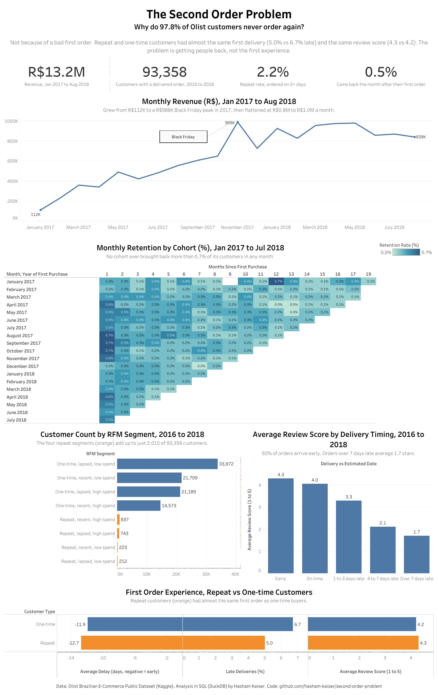
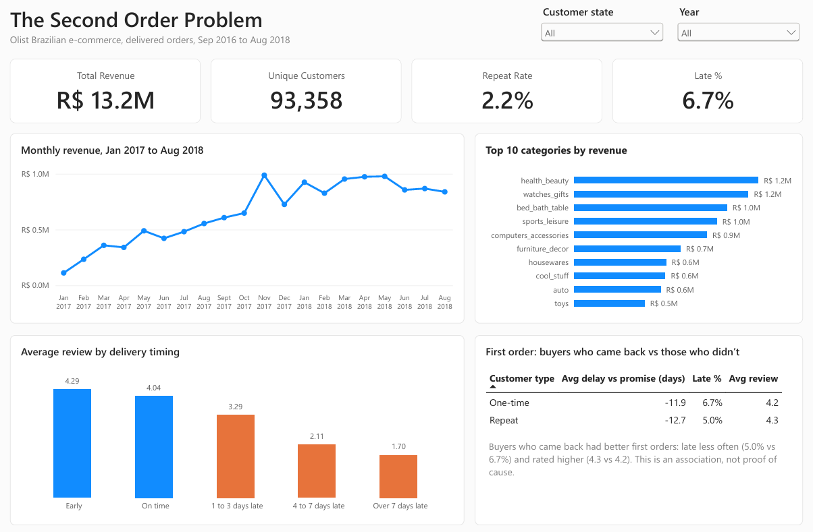
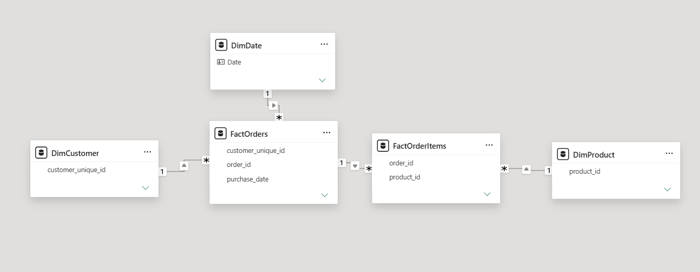

# The Second Order Problem

Why do 97.8% of customers on Olist, a Brazilian e-commerce platform, never place a second order? A SQL analysis of 99,441 orders across nine linked tables, published as a Tableau dashboard and a Power BI dashboard.

**[Tableau dashboard](https://public.tableau.com/app/profile/hasham.kaiser1104/viz/TheSecondOrderProblem/TheSecondOrderProblem)** · **[Power BI dashboard](https://app.powerbi.com/view?r=eyJrIjoiMGNhNjViYmItOWRjZi00YjhmLTgxOGEtMDNmM2JhNWJkOTk2IiwidCI6IjlkZGFhY2ExLTM4OWYtNGNiMS1hMTEzLTA4MWJlNmNjMjVmYyIsImMiOjZ9)** · **[Full notebook](notebooks/second-order-problem.ipynb)** · **[SQL queries](sql/)**



## Verdict

It is not the first order. Only 2.16% of customers ever came back, yet repeat and one-time buyers had similar first orders: early deliveries, similar review scores and similar costs. Olist is getting the first purchase right. What keeps customers from returning lies outside what this data captures, and the first step to fixing it is collecting the data that would reveal it.

## Dataset

The [Brazilian E-Commerce Public Dataset by Olist](https://www.kaggle.com/datasets/olistbr/brazilian-ecommerce) from Kaggle: 99,441 orders placed between September 2016 and October 2018, split across nine tables covering orders, items, payments, reviews, customers, sellers, products, category translations and geolocation.

Analysis uses the 96,478 delivered orders, placed by 93,358 unique customers. Revenue is reported in Brazilian reais (R$).

## Business Questions

1. How did revenue grow, and what drove it?
2. How many customers come back, and how long do they take?
3. Which customers are worth re-engaging?
4. Does delivery performance affect customer satisfaction?
5. Was the first order worse for customers who never came back?

## Key Findings

**Retention is the core problem.** 2,015 of 93,358 customers placed a second order on a different day, a repeat rate of 2.16%. In every monthly cohort, fewer than 1% of customers bought again in any later month, and later cohorts were no better than earlier ones.

**Growth stalled when acquisition did.** Monthly revenue grew from R$112k in January 2017 to a R$988k peak in November 2017, driven by Black Friday, then plateaued between R$826k and R$978k through 2018. With almost no repeat purchasing, there was no returning customer base to carry growth forward.

**The first order does not explain it.** Repeat and one-time buyers had similar first orders: late delivery rates of 5.0% and 6.7%, average reviews of 4.3 and 4.2, and freight at 31.6% and 30.8% of order value.

**Late deliveries hurt reviews, but they are rare.** Average review scores fall from 4.29 for early deliveries to 1.70 for orders more than 7 days late. Only about 7% of orders arrived late, too few to account for a 98% non-return rate.

**Customers who return take their time.** The median repeat customer placed a second order 74 days after the first, and 55% of second orders came within 90 days.

## Recommendations

| Action | Why |
|---|---|
| Make cohort retention a headline metric alongside revenue | Revenue grew through 2017 while repeat purchasing stayed below 1% in every cohort. Revenue alone hid the problem. |
| Collect post-purchase data: marketing contact, discounts, browsing after the first order | Without it, the cause of low retention cannot be identified. |
| Test re-engagement within 90 days of a first order, against a holdout group | 55% of second orders happen in that window. Start with the 14,573 one-time, recent, high spend customers. |
| Target the 743 repeat, lapsed, high spend customers for win-back | They have bought on at least two different days and sit in the top 40% of spend. |
| Keep delivery estimates conservative | Late orders average reviews as low as 1.70, even though delivery is not the main retention lever. |

## Question by Question

Each answer comes from one file in [`sql/`](sql/).

| Query | Question | Answer | So what |
|---|---|---|---|
| [00](sql/00_data_quality_checks.sql) | Is the data fit for analysis? | 96,478 of 99,441 orders were delivered. 547 orders have more than one review. 610 products have no category. | Reviews are averaged to one per order, and uncategorised products are kept and labelled, so no join duplicates or drops rows. |
| [01](sql/01_monthly_revenue.sql) | How did monthly revenue change? | R$112k in January 2017, a R$988k peak in November 2017, then a plateau of R$826k to R$978k. | Growth came from new customers and stopped when acquisition did. |
| [02](sql/02_category_revenue.sql) | Which categories drive revenue? | Health and beauty leads with 9.33%. The top five categories hold roughly 40% of revenue across 74. | No single category is a lever for growth. |
| [03](sql/03_seller_league.sql) | How concentrated is revenue among sellers? | The top seller holds 1.72% of revenue and the top 20 about 21%. | A fragmented platform that depends on no single seller. |
| [04](sql/04_same_day_orders.sql) | How many customers split one visit into several orders? | 857 customers placed more than one delivered order on the same day. | Counted as one visit, so split checkouts are not mistaken for repeat purchases. |
| [05](sql/05_repeat_rate.sql) | What share of customers came back? | 2,015 of 93,358, or 2.16%. | The central problem. |
| [06](sql/06_days_to_second_order.sql) | How long until a second order? | A median of 74 days. | Re-engagement works on a timescale of months, not days. |
| [07](sql/07_days_distribution.sql) | How are return times spread? | 30% within 30 days, 25% within 31 to 90, 21% within 91 to 180, 24% after 180. | No typical return window, which points to weak purchasing habits. |
| [08](sql/08_cohort_retention.sql) | How does each monthly cohort retain? | Below 1% in every month after the first purchase. Month 1 ranges from 0.2% to 0.7%. | The problem is structural, not a bad period. |
| [09](sql/09_rfm_segments.sql), [10](sql/10_rfm_distribution.sql) | How do customers segment on recency, frequency and spend? | The largest segment is one-time, lapsed, low spend (33,872, 36%). One-time, recent, high spend holds 14,573. | The recent high spenders are the natural group to test re-engagement on. |
| [11](sql/11_delivery_vs_reviews.sql) | Does late delivery affect reviews? | Average review falls from 4.29 (early) to 1.70 (over 7 days late). 92% of orders arrived early. | Lateness is associated with poor reviews, but it is rare. |
| [12](sql/12_first_order_experience.sql) | Were repeat buyers' first orders better? | Similar: late 5.0% vs 6.7%, review 4.3 vs 4.2, freight 31.6% vs 30.8%. | The first order does not explain low retention. |
| [13](sql/13_freight_by_state.sql) | How does freight cost vary by state? | From 13.9% of order value in São Paulo to 28.1% in the most expensive state. | Low-volume states pay about twice São Paulo's rate. |

## Approach

**Data quality first.** Before any question was answered, the notebook checks row counts, date ranges, orphan keys, duplicate keys and nulls, and turns the results into seven analysis rules that every query follows.

**SQL in DuckDB.** All nine tables are loaded into an in-memory DuckDB database. The queries use CTEs, multi-table joins and window functions (`LAG`, `RANK`, `ROW_NUMBER`, `NTILE`, `FIRST_VALUE`). Window functions that rank tied rows include a tie-breaker, so every result is identical on every run.

**Two dashboards, built two ways.**
- **Tableau** reads the summary tables the notebook exports to [`data/`](data/): KPI strip, monthly revenue, cohort retention heatmap, RFM segments, reviews by delivery timing and the first order comparison.
- **Power BI** is built from the raw tables to show the modelling layer. Power Query stages and cleans the raw files, a star schema joins two fact tables (orders, order items) to three dimensions (customer, product, date), and nine DAX measures calculate the KPIs, including `CALCULATE` with filters and a `DATEADD` month-over-month measure. Every figure was checked against the SQL output before publishing.





## Definitions

- **Customer:** `customer_unique_id`, which identifies a person. `customer_id` is assigned per order and is never used for retention.
- **Repeat customer:** delivered orders on at least two different calendar days.
- **Revenue:** the sum of item `price` on delivered orders. Freight is reported separately and payments are not used.
- **Trend window:** January 2017 to August 2018. The months outside it hold too few orders to show a real trend.

## Limitations

- **No post-purchase data.** The dataset records orders, deliveries and reviews, but nothing on marketing contact, discounts or browsing, which are the factors most likely to explain retention.
- **Associations, not causes.** The analysis is descriptive and no significance tests were run. Small differences, such as those between repeat and one-time buyers' first orders, should not be read as definitive.
- **The repeat rate is likely understated.** Customers who first bought in mid-2018 had only weeks to return before the data ends, against a median return time of 74 days. The cohort matrix accounts for this; the overall 2.16% does not.
- **Historical data.** The data covers 2016 to 2018 on one platform and may not reflect Olist today.

## How to Run

1. Download the dataset from the [Kaggle dataset page](https://www.kaggle.com/datasets/olistbr/brazilian-ecommerce).
2. The notebook's file paths are set for Kaggle. To run locally, place the nine CSVs in `data/raw/` and change the paths in the load cell to point there.
3. Install DuckDB and pandas: `pip install duckdb pandas`
4. To open the Power BI model, use Power BI Desktop (Windows) to open [`powerbi/second_order_problem.pbix`](powerbi/second_order_problem.pbix) and point the Power Query source steps at your copy of the files. A [PDF export](powerbi/second_order_problem.pdf) is included for viewing without Power BI.

## Repository

```
data/        summary tables exported by the notebook, read by Tableau
notebooks/   the full analysis
powerbi/     Power BI file, PDF export, dashboard and model screenshots
sql/         one query per question
tableau/     Tableau dashboard screenshot
```

## Tools

SQL (DuckDB), Python, Kaggle Notebooks, Tableau Public, Power BI (Power Query, DAX)
